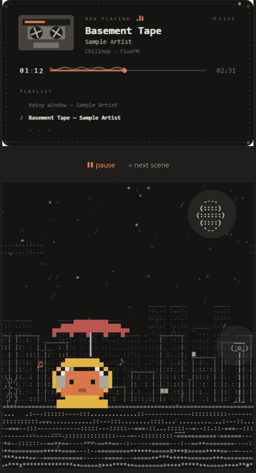
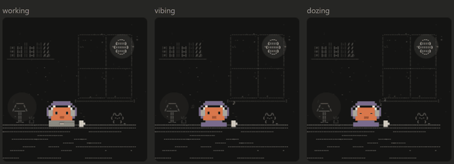
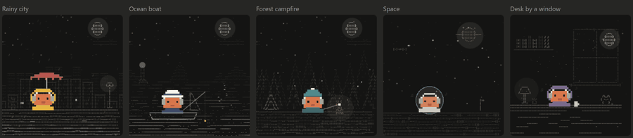

<div align="center">

# lofi-desk

**Lofi radio for the Claude Code desktop app.**<br>
A live now-playing card, a cosy animated ASCII scene, and a little pixel friend who works when Claude works.



`/music` and you're listening.

</div>

## Features

- **Real lofi radio.** Plays [FluxFM ChillHop](https://www.fluxfm.de/) live: instrumental lofi and chillhop at 320 kbit/s, with no account needed.
- **A now-playing card.** Shows the real song and artist, a slider with the song's length, and a short playlist with the last song, this one, and `· · ·` for what's next. The rows slide up when a new song starts.
- **Five original scenes.** A rainy city rooftop, a boat at sea, a forest campfire, a tiny moon in deep space and a desk by a window. They change by themselves every three minutes.
- **The sky follows your clock.** Night, dawn, day and dusk, with stars, a moon or sun, clouds and the odd shooting star.
- **Scenes that are always alive.** Ground textures sway like wind, dust drifts past, rain falls, and the ASCII slowly shimmers.
- **A pixel character who reacts to Claude.** It dresses for each scene and changes with what Claude is doing:

<div align="center">

</div>

| Mood | When |
| --- | --- |
| **working** | Claude is running tools. The laptop comes out and the character types. |
| **vibing** | Music is on and Claude is idle. The character bobs along as notes float up. |
| **dozing** | Nothing has happened for two minutes. `z z z` |

## The scenes

<div align="center">

</div>

| Scene | The character wears |
| --- | --- |
| Rainy city | a raincoat, with an umbrella |
| Ocean boat | a sailor cap, with a fishing rod |
| Forest campfire | a beanie, toasting a marshmallow |
| Space | a helmet, floating |
| Desk by a window | a hoodie, with a mug |

All art is drawn from scratch for this mod.

## Install

In a terminal:

```sh
claude plugin marketplace add Horali/claude-lofi
claude plugin install lofi-desk@lofi-desk-market
```

Then type `/music` in a Claude Code chat in the desktop app.

**On Windows, also install ffmpeg** for the smoothest playback. The mod falls back to Windows Media Player without it, but ffmpeg is more reliable:

```powershell
winget install Gyan.FFmpeg
```

## Commands

| Command | What it does |
| --- | --- |
| `/music` | Starts the radio and opens the pane. Run it again to stop. |
| `/music next` | Switches to the next scene. |
| `/music fm` | Stops the radio and opens the Claude FM livestream on YouTube in your browser. |
| `/music light` | Calmer scenes that use less of your computer: no shimmer or swaying ground, fewer specks. Remembered across sessions. |
| `/music full` | Back to full motion (the default). |

The pane also has **▶ play / ❚❚ pause** and **» next scene** buttons. You can ask Claude too, for example "turn on the music" or "next scene".

## How it works

- **Playback.** The mod tries these players in order: the app's own player (not on Windows), `ffplay` (from ffmpeg), `mpv`, VLC, then Windows Media Player. The audio is streamed live and never saved.
- **Song names** come from the song list FluxFM's own website uses, checked every 20 seconds. If that is down, the mod reads the stream's title instead.
- **Song lengths** come from Apple's public iTunes search, with MusicBrainz as a backup. Only the artist and song title are sent, never anything about you. A song neither knows shows `--:--`.
- **In a terminal** (outside the desktop app) the pane shows a short text version with the same buttons.

## FAQ

**I don't hear anything.**
Install ffmpeg (see Install above) and run `/music` twice to restart the radio.

**Can I pick my own station?**
Not yet. The mod plays FluxFM ChillHop because FluxFM publishes the stream address for outside players.

**Does it download music from YouTube?**
No. `/music fm` only opens the livestream in your browser.

## The station and its terms

The radio is **FluxFM ChillHop**. FluxFM publishes this stream address on its page "Für externe Player" ("for external players"), which invites use in outside players. The mod plays it live and never saves the audio. SomaFM was ruled out because its terms ban third-party apps.

lofi-desk is a fan-made mod. It is not affiliated with Anthropic, FluxFM or any artist played on the station.

## Development

```sh
claude plugin validate .        # check the manifest and the hooks module
claude plugin test .            # run the tests in tests/
node scripts/preview.mjs pane 31x39,62x39 city night vibing   # a stand-in pane in .preview/
node scripts/sheet.mjs          # a contact sheet of every scene
node scripts/record.mjs docs/pane.gif   # record the preview into a GIF (needs Chrome or Edge, and ffmpeg)
```

Serve `.preview/` with the `preview` entry in `.claude/launch.json` (port 8790). The scripts need Node 22.18 or later.

## License

[MIT](LICENSE) © Horali. The license covers this mod's code and art. The music belongs to its artists and FluxFM.
